<div align="center">

# KC

**The AI workforce for North African commerce.**

Trilingual AI employees (Arabic · French · English) that sell, support, and grow
your store 24/7 across WhatsApp, Instagram, Messenger and Telegram — with a
real Algerian delivery module built in.

<sub>Built with TanStack Start · React 19 · Tailwind v4 · Supabase · Cloudflare Workers</sub>

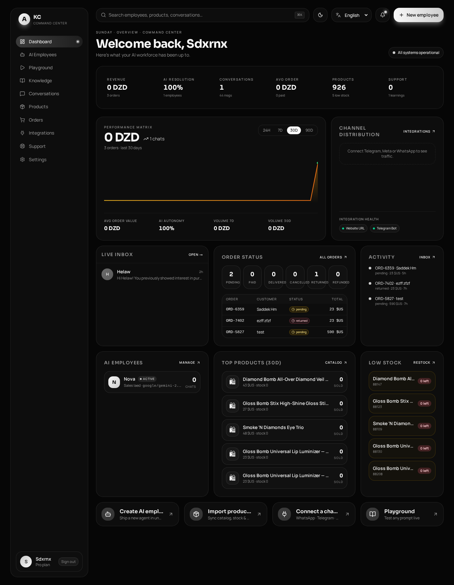

</div>

---

## Table of contents

- [Why KC](#why-kc)
- [KC vs the competition](#kc-vs-the-competition)
- [Screenshots](#screenshots)
- [Feature tour](#feature-tour)
- [Architecture](#architecture)
- [Local development](#local-development)
- [Environment variables](#environment-variables)
- [Project structure](#project-structure)
- [Security & privacy](#security--privacy)
- [License](#license)

---

## Why KC

Most support/chat platforms were designed for English-speaking SaaS teams in
North America or Europe. KC is built for the way commerce actually works in
**Algeria, Morocco and Tunisia** — Darija-first customers, cash on delivery,
Yalidine / ZR Express shipments, Instagram DMs closing more orders than a
website ever will.

### 10 reasons store owners pick KC

1. **Native Darija + French + Arabic on every surface.** Not Google-translated
   afterwards — the UI, prompts and customer replies are translated at build
   time and again live via a MutationObserver, so nothing is ever half-English.
2. **Real Algerian delivery module.** All 58 wilayas seeded, per-zone pricing,
   free-shipping thresholds, COD amount separate from order total, carrier
   assignment (Yalidine, ZR Express, Ecouriers, Rapidex, custom manual) and a
   full tracking timeline.
3. **Order closing inside the chat.** COD, CIB, BaridiMob — the AI collects
   wilaya, commune, phone, quotes shipping, confirms and writes the order to
   your database. No "click this link to check out".
4. **Bring-your-own model.** OpenAI-compatible, Claude, Mistral, Gemini,
   OpenRouter, or the built-in Lovable AI Gateway. Live "connection healthy"
   status chip per employee.
5. **Real catalog scraper.** Paste a Shopify / WooCommerce / YouCan URL and KC
   ingests products, images, prices and stock. Warns you when a custom domain
   can't expose stock so the AI never lies about availability.
6. **The AI actually learns from confirmed conversations.** A `workspace_learnings`
   feed captures winning replies and injects them back into future prompts.
7. **Human handoff, presence and typing signals.** One click pauses the AI on
   a thread and pings a human. Presence heartbeat keeps the inbox honest.
8. **Serious admin panel.** Every workspace, every user, every KPI, live
   broadcasts, ban/unban, impersonation, security dashboard with 2FA adoption
   and rate-limit blocks.
9. **Security posture that a bank would recognise.** RLS on every table, TOTP
   2FA with backup codes and 8-hour re-verify window for destructive actions,
   DB-backed per-user rate limits, audit log, GDPR export/delete, SSRF-guarded
   fetches, `noindex` + `Cache-Control: private, no-store` on every
   authenticated route.
10. **Modern stack, edge runtime.** TanStack Start on Cloudflare Workers.
    Server functions, streaming SSR, MCP tools, PWA install prompt. Boots in
    ms, scales to zero.

---

## KC vs the competition

How KC stacks up against the four platforms Algerian store owners most often
compare it with. ✅ = shipped, 🟡 = partial / paid add-on, ❌ = not available.

| Capability | **KC** | Manychat | Chatfuel | Tidio | Gorgias |
|---|:---:|:---:|:---:|:---:|:---:|
| Native Darija / Arabic UI | ✅ | ❌ | ❌ | 🟡 (auto-translate) | ❌ |
| WhatsApp + Instagram + Messenger + Telegram | ✅ | ✅ (WA + Meta) | ✅ (WA + Meta) | ✅ (WA + Meta) | ✅ |
| Bring-your-own LLM (OpenAI / Claude / Gemini / OpenRouter) | ✅ | ❌ | ❌ | ❌ | 🟡 |
| Order closing inside the chat (COD / CIB / BaridiMob) | ✅ | ❌ | ❌ | ❌ | ❌ |
| Algerian delivery module (58 wilayas, Yalidine / ZR Express) | ✅ | ❌ | ❌ | ❌ | ❌ |
| COD amount tracked separately from order total | ✅ | ❌ | ❌ | ❌ | 🟡 |
| Real catalog scraper (Shopify / Woo / YouCan / custom) | ✅ | ❌ | ❌ | 🟡 | 🟡 |
| Product cards & one-click order inside chat | ✅ | 🟡 | 🟡 | 🟡 | ❌ |
| AI learns from confirmed conversations | ✅ | ❌ | ❌ | ❌ | 🟡 |
| Human handoff + presence + typing | ✅ | ✅ | 🟡 | ✅ | ✅ |
| Workspace-level admin, impersonation, broadcasts | ✅ | ❌ | ❌ | ❌ | 🟡 |
| TOTP 2FA + audit log + GDPR export/delete | ✅ | 🟡 | ❌ | 🟡 | ✅ |
| MCP tools for external agents | ✅ | ❌ | ❌ | ❌ | ❌ |
| PWA + install prompt | ✅ | ❌ | ❌ | ❌ | ❌ |
| Self-hostable / open architecture | ✅ | ❌ | ❌ | ❌ | ❌ |
| **Starting price (SMB, per month)** | **Free trial · then DZD-priced** | $15 | $23 | $29 | $60 |

> Sources: public pricing pages and feature docs of each vendor as of 2026.
> KC is the only one on this list built specifically for North African commerce.

---

## Screenshots

Every page in both **dark** and **light** mode.

### Marketing

| Page | Dark | Light |
|---|---|---|
| Landing |  |  |
| Pricing |  | 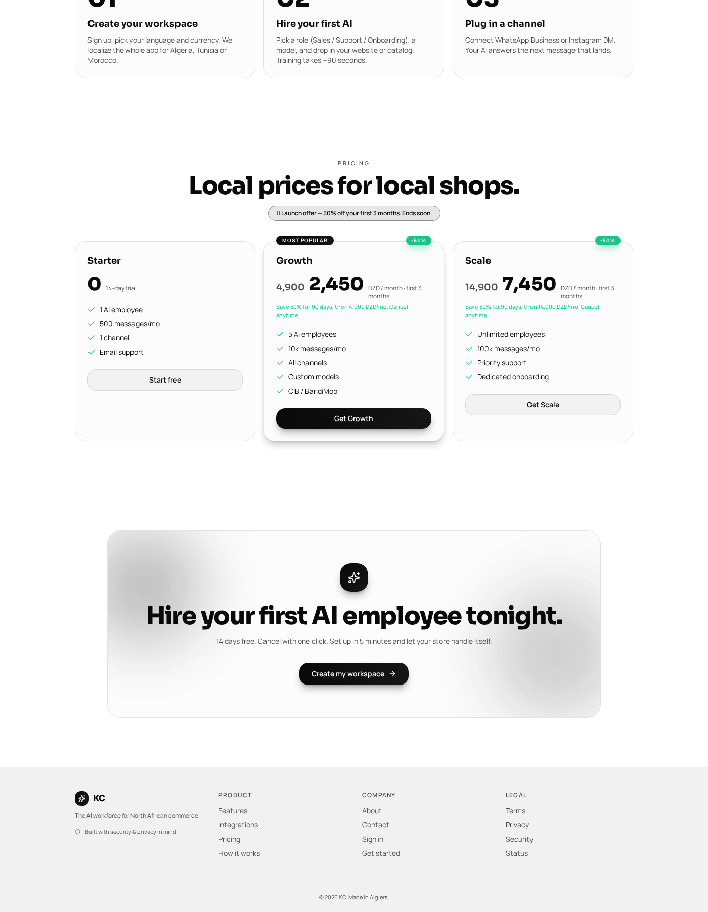 |
| About | 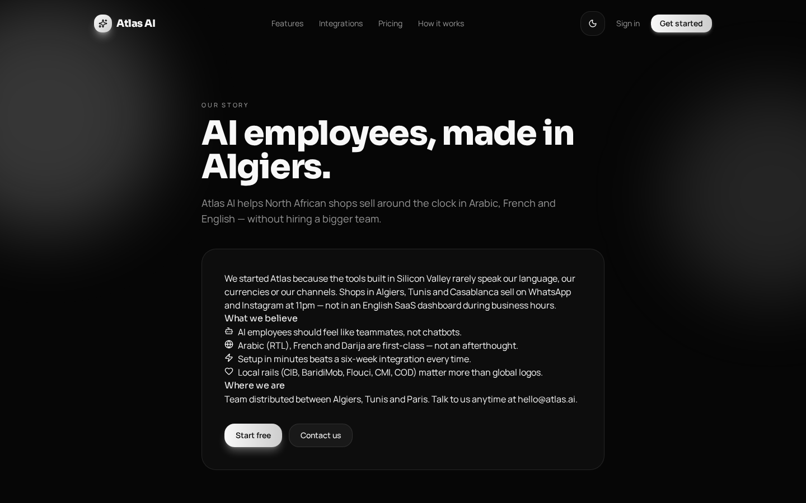 | 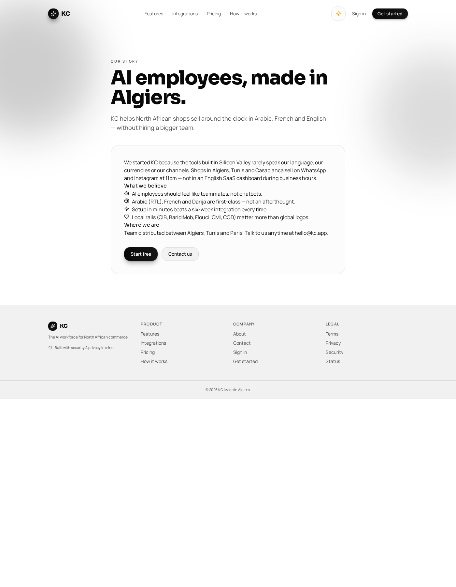 |
| Contact |  |  |

### Auth

| Page | Dark | Light |
|---|---|---|
| Login |  |  |
| Signup | 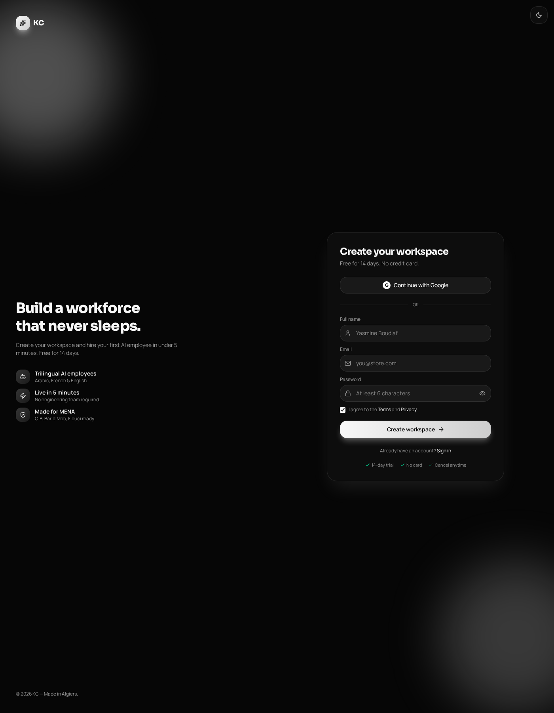 | 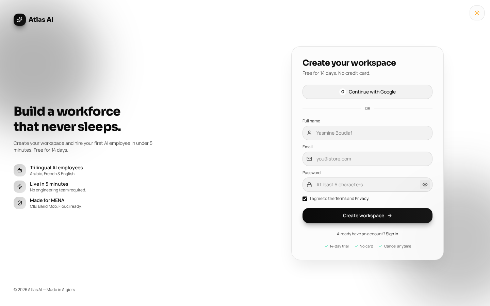 |

### Product surfaces

| Page | Dark | Light |
|---|---|---|
| Dashboard |  | 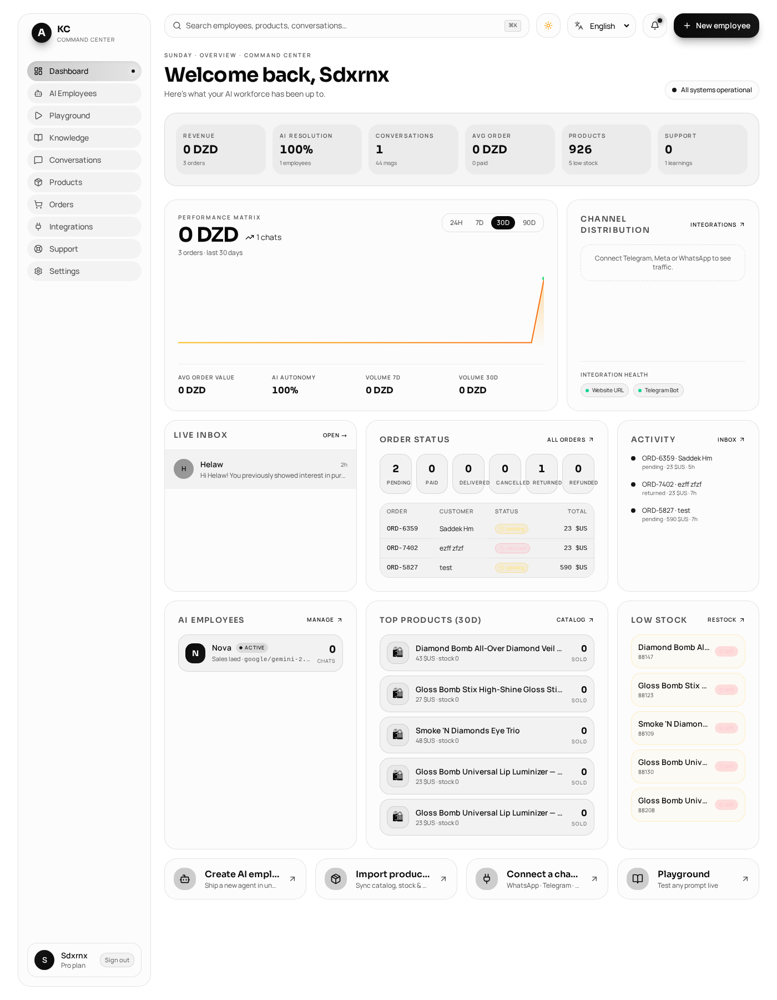 |
| AI Employees | 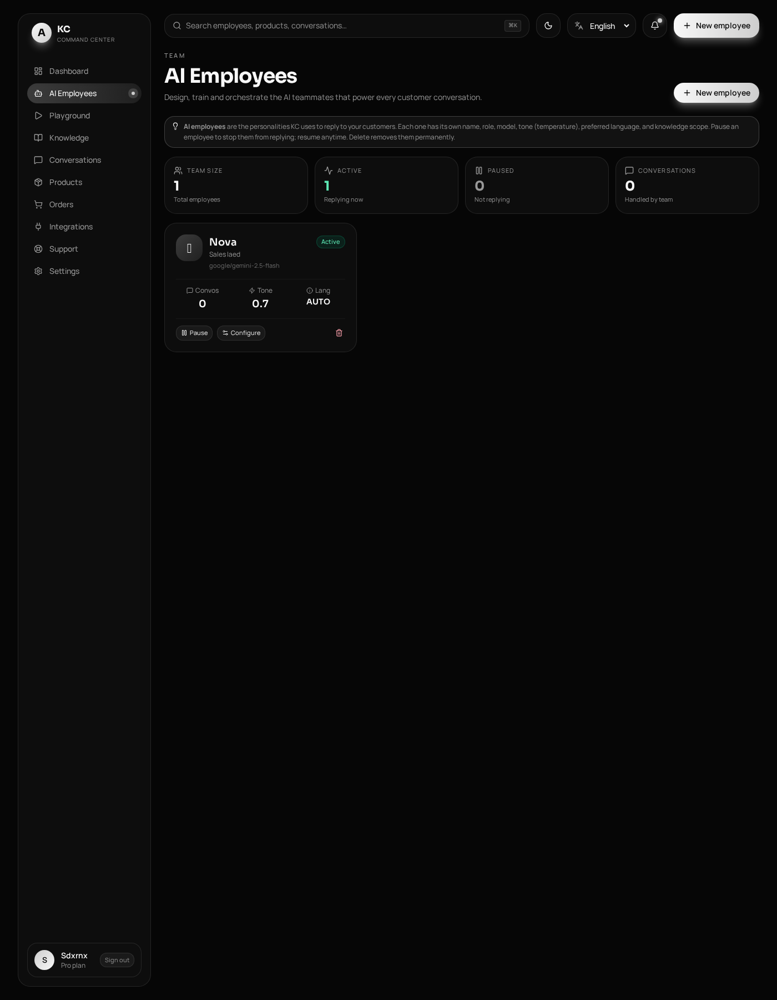 |  |
| Products |  |  |
| Orders |  | 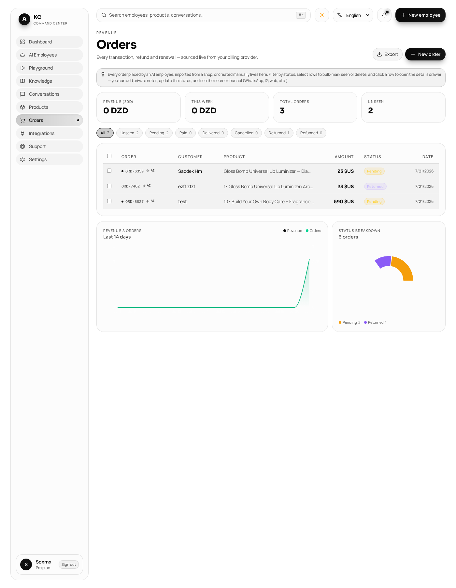 |
| Conversations | 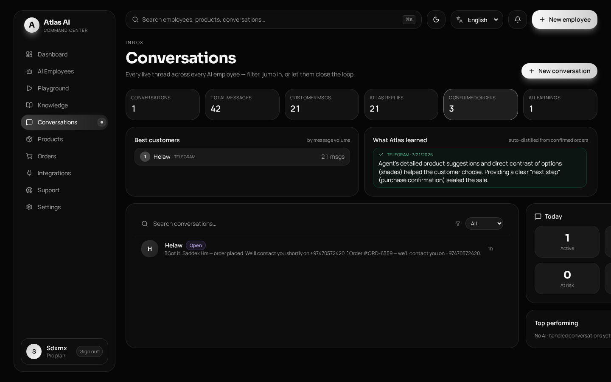 |  |
| Integrations | 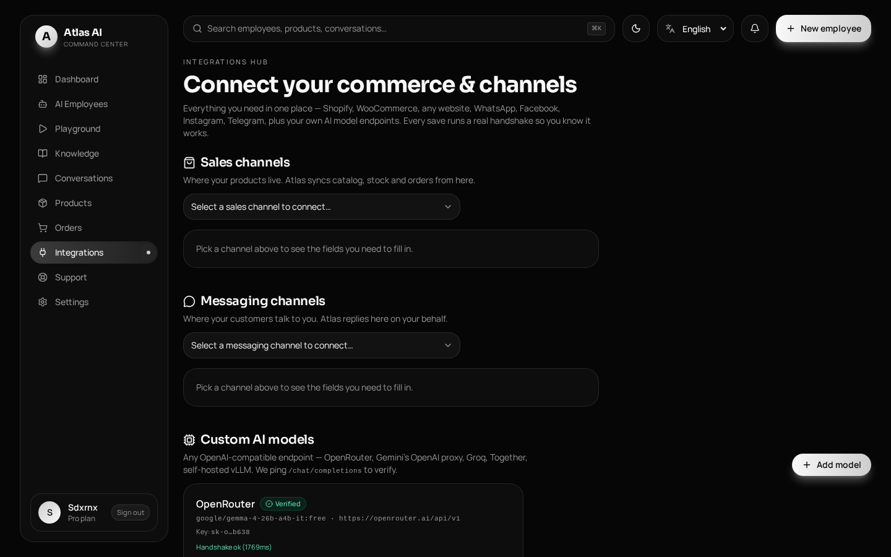 |  |
| Knowledge |  | 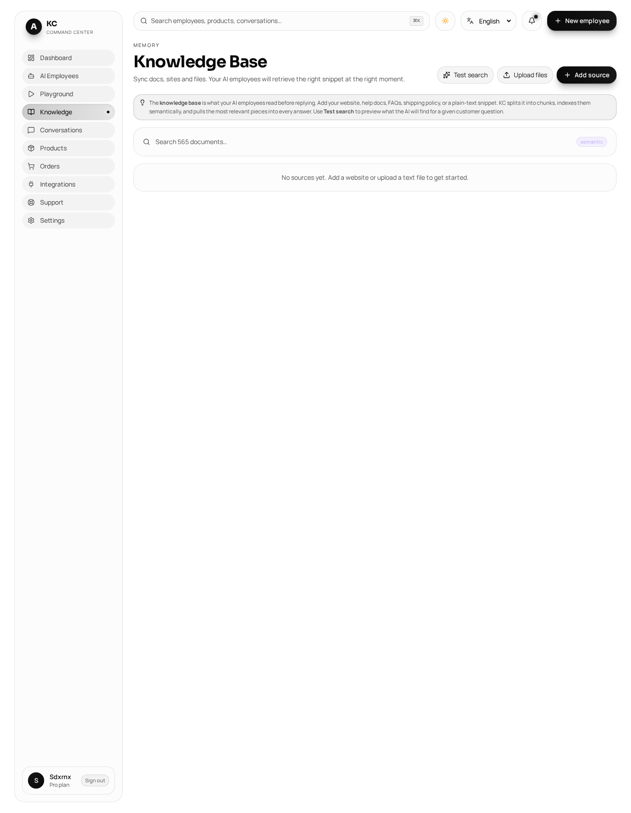 |
| Playground |  |  |
| Settings | 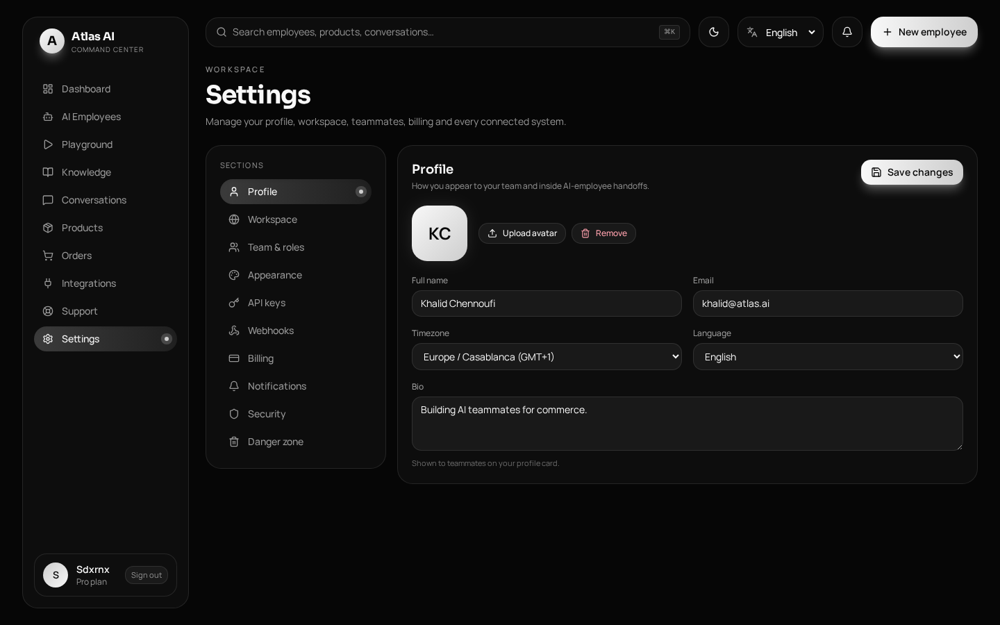 | 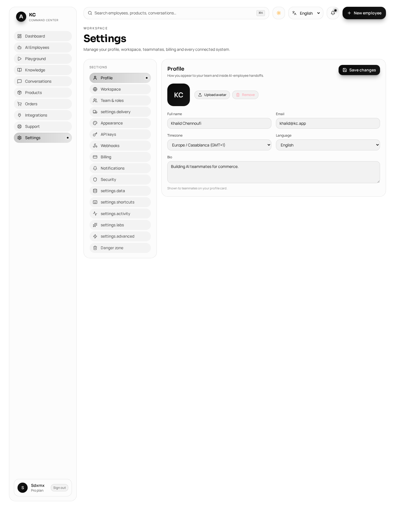 |
| Support |  |  |
| Admin |  | 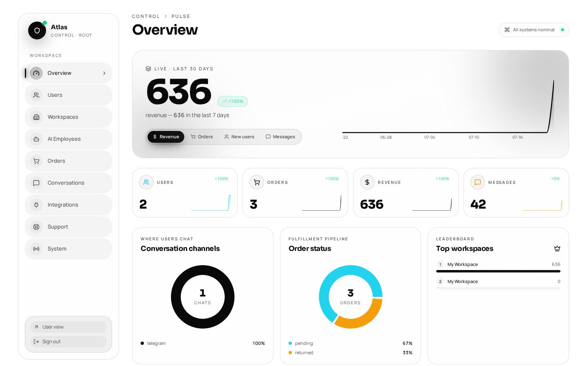 |

---

## Feature tour

### Marketing site
Landing, pricing with launch discount, feature comparison, about, contact,
terms, privacy, security, real-time status page, `sitemap.xml`, `robots.txt`,
`llms.txt`. Every page has its own `<head>` metadata and `og:image`.

### Auth & onboarding
Email + password, Google OAuth, password reset. 5-step onboarding that
provisions a workspace, sets currency + wilaya defaults, connects the first
social channel and offers a **Skip** at every step.

### Dashboard
Bento command centre: revenue, AI resolution rate, conversations, avg order,
product count, support tickets, live performance chart, channel distribution,
live inbox, order-status funnel, top products, low-stock alerts and a
"Since you were away" summary per social channel.

### AI Employees
Templates marketplace, per-employee model picker (OpenAI-compatible / Claude /
Gemini / Mistral / OpenRouter / Lovable AI), live connection health chip,
tone + persona controls, guardrails scoped to the workspace catalog.

### Products & catalog
Scraper for Shopify JSON / WooCommerce / YouCan / arbitrary sites via sitemap
discovery. Stats, filters (day / week / month / new / low-stock), pagination
(default 8, user-configurable). Warns on custom domains where stock is
unreliable.

### Orders & delivery
Full Algerian delivery module: 58 wilayas seeded, `carriers` + `shipping_zones`
per workspace, free-shipping thresholds, COD amount tracked separately,
carrier assignment, tracking number, delivery timeline, status history and a
shipping webhook endpoint.

### Conversations & inbox
Multi-channel inbox (WhatsApp, Instagram, Messenger, Telegram, Viber
placeholder). Smart greetings, order memory, bold formatting, real product
cards, one-click **Order** button, human handoff, learning feed.

### Integrations hub
Meta / Telegram / Viber handshakes, external model manager with health
checks, website scraper, inbound webhooks page, MCP server for external agents.

### Knowledge base
Long-form documents, FAQ entries and scraped pages become retrieval context
for every AI employee.

### Playground
Prompt tester with the model picker fixed at the top and the conversation
docked to the bottom. Rate-limited per user.

### Settings
General, Team, Billing, Delivery (carriers + zones + free-shipping
thresholds), Notifications, Appearance, Advanced (2FA, audit log, GDPR
export/delete, backups & restore, referral code, storefront slug, currency),
API keys.

### Support
Direct thread to the KC admin. Admin can pin, escalate, ban / unban, and
impersonate the workspace to fix issues live.

### Admin panel
Every workspace, every user, every KPI. Deep-dive drawers, `recharts`
analytics, live broadcast popups, ban controls, impersonation, security
dashboard with 2FA adoption, rate-limit blocks and audit events.

---

## Architecture

- **Framework**: TanStack Start v1 (React 19, Vite 7, streaming SSR)
- **Runtime**: Cloudflare Workers (`nodejs_compat`)
- **Backend**: Supabase (Postgres 15, RLS, Realtime, Auth, Storage)
- **Styling**: Tailwind v4 with `oklch` monochrome tokens in `src/styles.css`
- **AI**: Lovable AI Gateway (default) + bring-your-own model per workspace
- **Agent tools**: `@lovable.dev/mcp-js` — workspaces / products / orders exposed as MCP
- **i18n**: build-time Gemini translation + runtime `MutationObserver` in `src/lib/auto-translate.tsx`
- **PWA**: install prompt + manifest + service worker

### Route map

```
/                       Landing
/pricing                Pricing
/about /contact         Marketing
/terms /privacy /security /status
/login /signup /reset-password
/onboarding             5-step wizard
/dashboard              Bento command centre
/ai-employees           AI workforce
/products               Catalog + scraper
/orders                 Orders + Algerian delivery
/conversations          Multi-channel inbox
/integrations           Integrations hub
/knowledge              Knowledge base
/playground             Prompt tester
/settings               Settings (Delivery, Advanced, ...)
/support                Support thread
/admin                  Admin panel (role-gated)
/store/:slug            Public storefront
/api/public/*           Public webhooks (signature-verified)
```

---

## Local development

```bash
bun install
bun dev
```

The dev server listens on `http://localhost:8080`. Cloud (Supabase) credentials
are provisioned automatically inside Lovable.

---

## Environment variables

Client (`VITE_*`, safe to expose):

- `VITE_SUPABASE_URL`
- `VITE_SUPABASE_PUBLISHABLE_KEY`
- `VITE_SUPABASE_PROJECT_ID`

Server-only (never sent to the browser):

- `LOVABLE_API_KEY` — AI Gateway
- `SUPABASE_SERVICE_ROLE_KEY` — server-only admin client
- Optional per-workspace: `OPENAI_API_KEY`, `ANTHROPIC_API_KEY`, `GEMINI_API_KEY`, `OPENROUTER_API_KEY`, carrier API keys

---

## Project structure

```
src/
  routes/            file-based TanStack routing (pages + /api/public webhooks)
  components/        UI + page shells + admin panel
  lib/               server functions (*.functions.ts), server-only (*.server.ts),
                     i18n, preferences, MCP tools
  integrations/      auto-generated Supabase clients (do not edit)
  styles.css         Tailwind v4 tokens (monochrome, light + dark)
supabase/migrations/ SQL migrations (RLS + grants on every public table)
docs/screenshots/    Screenshots used in this README
public/              robots.txt, sitemap references, PWA manifest
```

---

## Security & privacy

- Row Level Security on every `public.*` table with explicit `GRANT`s
- Roles stored in `public.user_roles` and checked with a `SECURITY DEFINER` `has_role()` function — never on the profile
- TOTP 2FA with backup codes; 8-hour re-verify window for destructive admin actions
- DB-backed per-user rate limits (`public.rate_limits`, `public.rate_limit_hit`) on playground, admin, broadcast and translation buckets
- Audit log via `public.security_events`
- GDPR export + delete tools in Settings → Advanced
- SSRF-guarded fetches (`safeFetch`) for the scraper and BYO-model calls
- `noindex, nofollow` meta + `X-Robots-Tag: noindex` + `Cache-Control: private, no-store` on every authenticated route
- Public webhooks live only under `/api/public/*` and verify signatures inside the handler

---

## License

Proprietary — © KC. All rights reserved.
