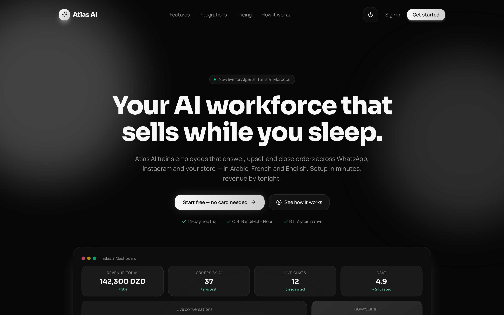
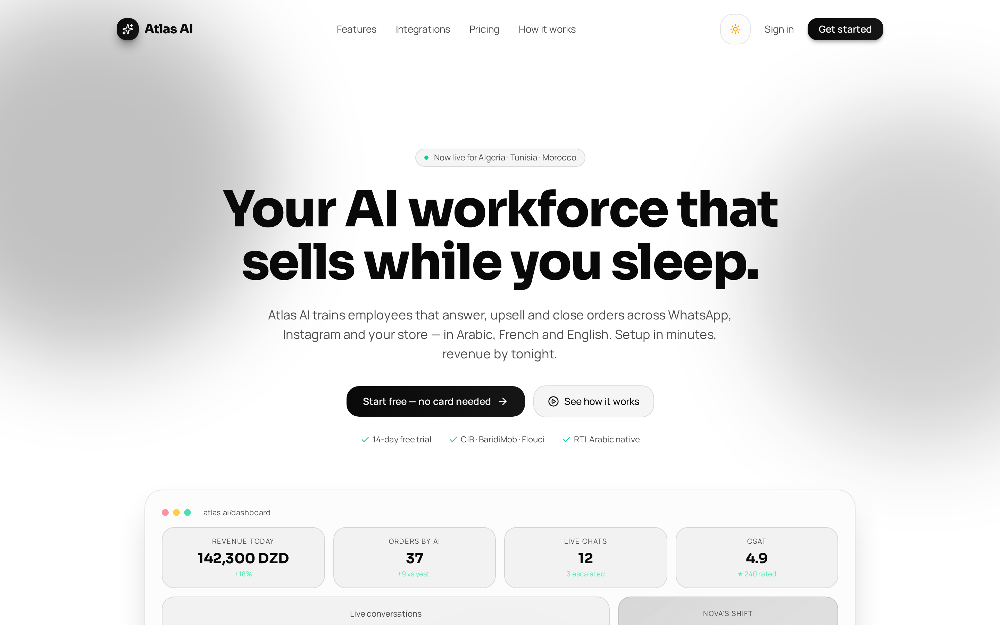
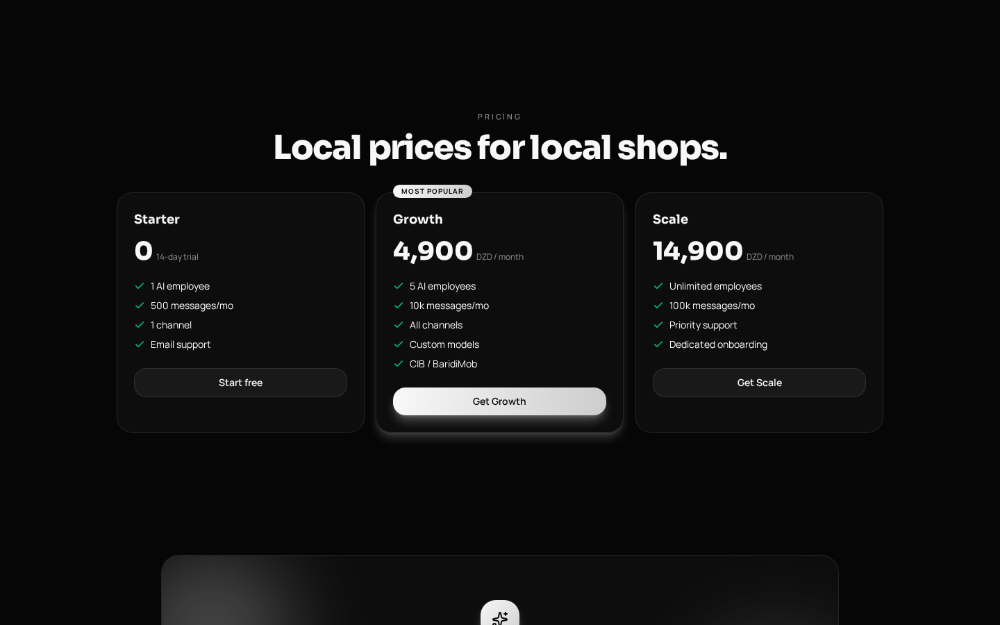
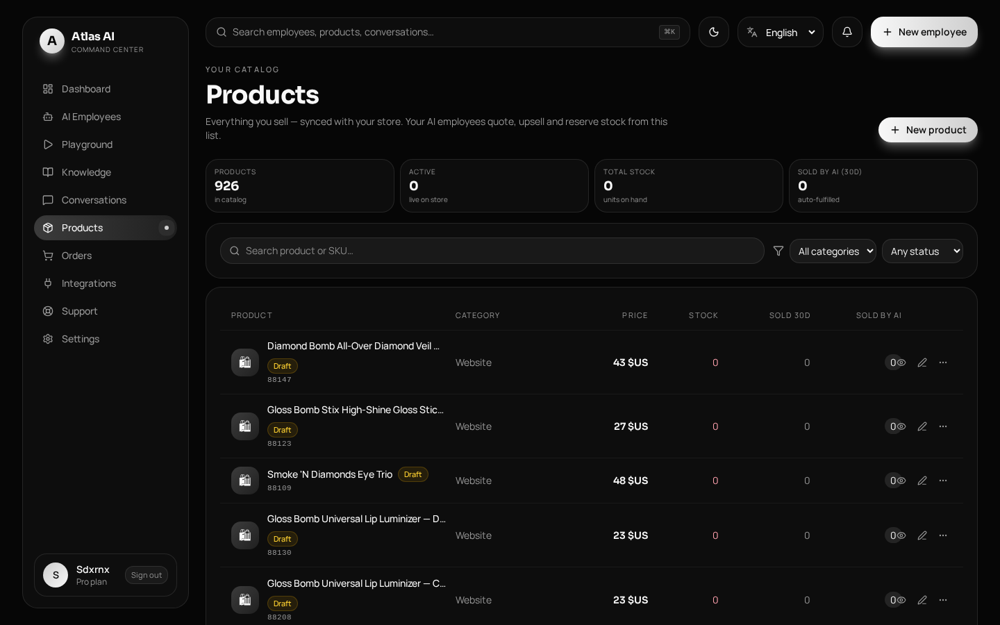
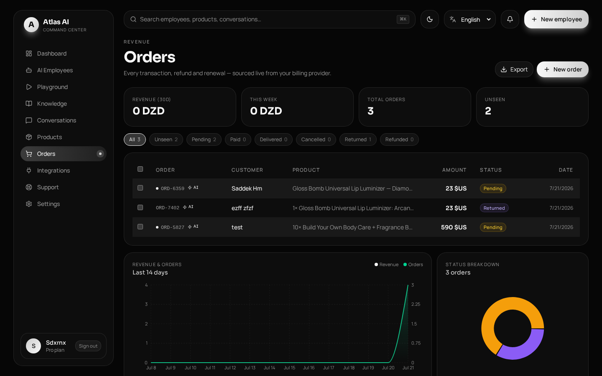
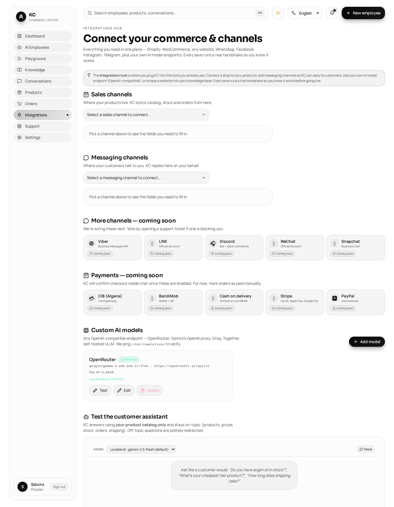
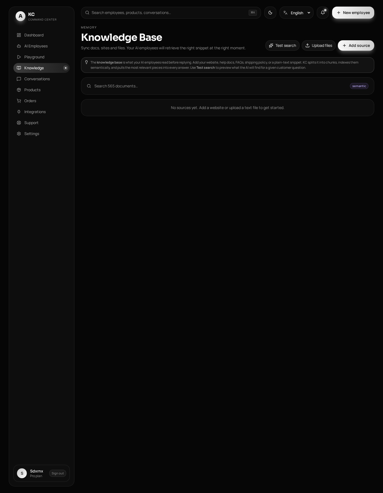
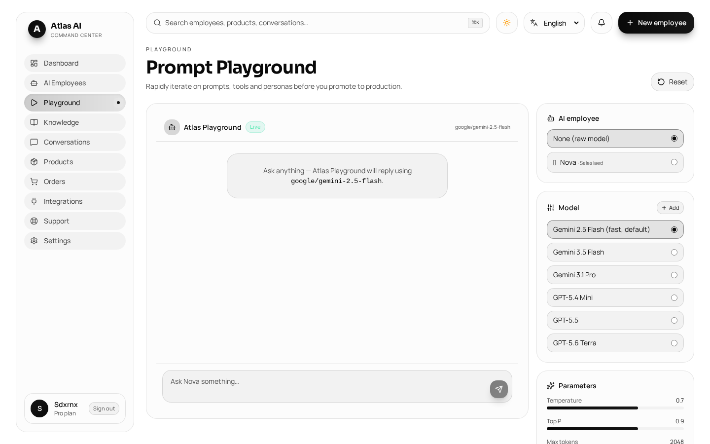
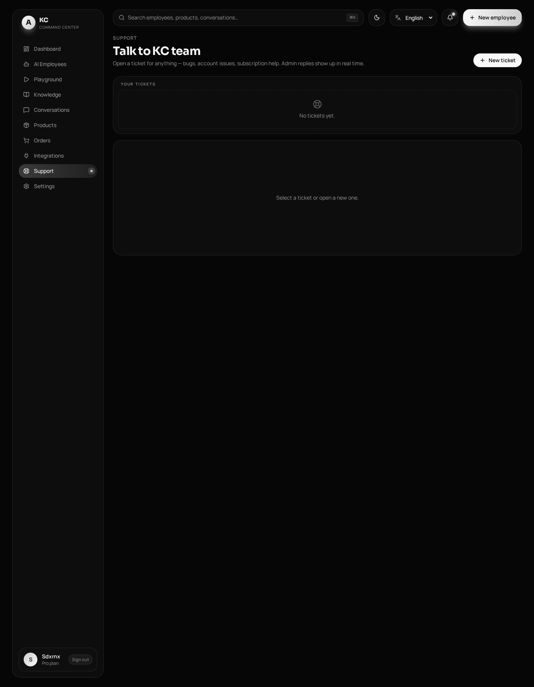
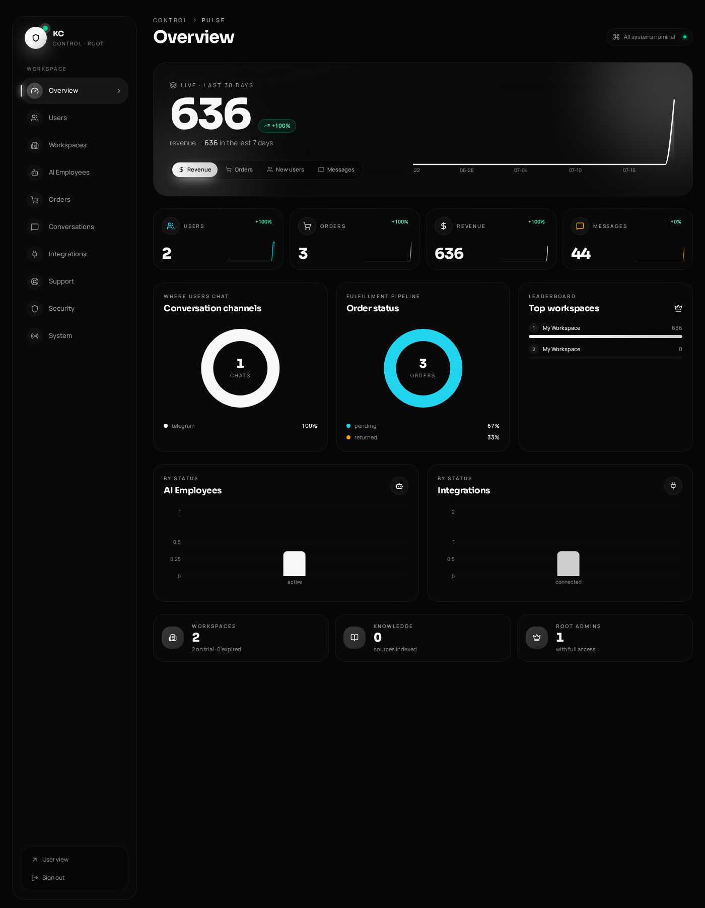

<div align="center">

# ✨ KC

### The AI workforce for North African commerce.

Trilingual (🇬🇧 English · 🇫🇷 Français · 🇩🇿 العربية) AI employees that answer, upsell and close orders across WhatsApp, Instagram, Telegram and your store — while you sleep.

[](https://tanstack.com/start)
[](https://react.dev)
[](https://tailwindcss.com)
[](https://supabase.com)
[](#-license)

</div>

---

## 📚 Table of contents

- [What is KC?](#-what-is-kc-ai)
- [Dual theme — dark & light](#-dual-theme--dark--light)
- [Marketing surfaces](#-marketing-surfaces)
- [Authentication](#-authentication)
- [In-app pages, one by one](#-in-app-pages-one-by-one)
- [Admin panel](#-admin-panel)
- [Tech stack](#-tech-stack)
- [Getting started](#-getting-started)
- [Project structure](#-project-structure)
- [One-click publish to GitHub](#-one-click-publish-to-github)
- [Scripts](#-scripts)
- [License](#-license)

---

## 🌍 What is KC?

KC is an all-in-one commerce cockpit built for shops in **Algeria, Tunisia and Morocco**. It gives every store an AI workforce that:

- **Answers** customer DMs in Arabic, Darija, French and English — round the clock.
- **Recommends** real products from your catalog, with tap-to-order product cards.
- **Closes** orders with local payment rails (CIB, BaridiMob, Flouci, CMI, Cash on Delivery).
- **Learns** from every confirmed sale so the whole workforce gets sharper.
- **Reports** revenue, CSAT, escalations and channel performance in real time.

Everything is designed to feel native to the region — RTL Arabic, DZD/TND/MAD, WhatsApp-first — not a Silicon Valley SaaS translated as an afterthought.

---

## 🎨 Dual theme — dark & light

Both modes are first-class. Toggle with the sun/moon button in any navigation surface; the choice persists per user.

<table>
  <tr>
    <td align="center"><b>🌙 Dark</b></td>
    <td align="center"><b>☀️ Light</b></td>
  </tr>
  <tr>
    <td></td>
    <td></td>
  </tr>
</table>

---

## 🚀 Marketing surfaces

Fully SSR-rendered, indexable, with per-route metadata + JSON-LD, robots.txt, sitemap.xml and an llms.txt for AI crawlers.

### Landing page
Aurora hero, product tour, integrations grid, pricing, FAQ, footer nav — every button routes to a real destination.

<table>
  <tr>
    <td></td>
    <td></td>
  </tr>
</table>

### Pricing
14-day free trial on every paid plan; trial state is enforced in the app and blocks premium features when it expires.

<table>
  <tr>
    <td></td>
    <td></td>
  </tr>
</table>

### About & Contact
Team story, mission and a working contact form that files a support ticket in the admin queue.

<table>
  <tr>
    <td align="center"><b>About</b></td>
    <td align="center"><b>Contact</b></td>
  </tr>
  <tr>
    <td></td>
    <td></td>
  </tr>
  <tr>
    <td></td>
    <td></td>
  </tr>
</table>

---

## 🔐 Authentication

Email + password with confirmation, Google OAuth (one-click), and a full **Reset password** flow. Role-based routing sends admins to `/admin` and merchants to `/dashboard`. Every server function is guarded by `requireSupabaseAuth` middleware; the workspace is auto-provisioned on first sign-in via a Postgres trigger.

<table>
  <tr>
    <td align="center"><b>Sign in</b></td>
    <td align="center"><b>Sign up</b></td>
  </tr>
  <tr>
    <td></td>
    <td></td>
  </tr>
  <tr>
    <td></td>
    <td></td>
  </tr>
</table>

---

## 🧭 In-app pages, one by one

### 📊 Dashboard — command center
Personalized welcome, live KPI tiles (revenue, orders by AI, live chats, CSAT), a **Conversation Volume** chart with 1D/7D/30D/90D toggles, "Since you were away" summary, AI suggestions ("Train Ember on your new fall catalog"), and live channel feeds.

<table>
  <tr>
    <td></td>
    <td></td>
  </tr>
</table>

### 🤖 AI Employees
Create, edit and deploy AI teammates. Pick a **model** (Lovable AI, OpenRouter, Gemini, any OpenAI-compatible endpoint), tone, language, escalation rules and product scope. Live connection chip verifies the model key works before you publish.

<table>
  <tr>
    <td></td>
    <td></td>
  </tr>
</table>

### 🛍️ Products
Full CRUD catalog with images, variants, stock and channel visibility. Bulk import via **website scraper** (Shopify JSON, sitemap discovery, plain HTML fallback) with an honest "stock unknown — check site" warning for scraped items. Compact card grid; the "more" menu is portal-rendered so it never gets covered.

<table>
  <tr>
    <td></td>
    <td></td>
  </tr>
</table>

### 📦 Orders
Full order pipeline: **new → confirmed → packed → shipped → delivered → cancelled/refunded**, with revenue chart, status stats, bulk actions, channel origin (WhatsApp/IG/Telegram/Web), and a side drawer for private notes and full order history.

<table>
  <tr>
    <td></td>
    <td></td>
  </tr>
</table>

### 💬 Conversations (Inbox)
Unified inbox across all channels. Threaded messages, human takeover, sentiment tags, escalation flags, live typing indicators, and inline **product cards** the customer can tap to order without leaving the chat.

<table>
  <tr>
    <td></td>
    <td></td>
  </tr>
</table>

### 🔌 Integrations
Connect **WhatsApp, Instagram, Facebook Messenger, Telegram** with signed-webhook handshake. Bring-your-own-key **Model Manager** for OpenRouter / Gemini / OpenAI-compatible providers with live latency + token cost check. Website scraper, Shopify sync, and a webhook inspector.

<table>
  <tr>
    <td></td>
    <td></td>
  </tr>
</table>

### 📚 Knowledge base
Upload PDFs, docs, FAQs and URLs. Files are chunked, embedded and served as grounding context to the AI. RLS-protected storage bucket with signed URLs for previews.

<table>
  <tr>
    <td></td>
    <td></td>
  </tr>
</table>

### 🧪 Playground
Live chat sandbox to test any AI employee against your catalog before going live. Shows the raw tool calls, product matches and reasoning trace so you can debug prompts fast.

<table>
  <tr>
    <td></td>
    <td></td>
  </tr>
</table>

### 🎫 Support
Direct line from merchants to admin. Threaded conversations, attachments, status (open / waiting / resolved) and realtime updates via Supabase channels.

<table>
  <tr>
    <td></td>
    <td></td>
  </tr>
</table>

### ⚙️ Settings
Workspace profile, team roles, language (EN / FR / AR with RTL), theme (dark / light + 11 accent palettes), motion preferences, notification channels, billing plan and API keys.

<table>
  <tr>
    <td></td>
    <td></td>
  </tr>
</table>

---

## 👑 Admin panel

Restricted to the admin email. Full visibility into every workspace, user, AI employee, order, conversation, integration and support ticket — plus:

- KPI overview across the whole platform (users, workspaces, revenue, escalations).
- **Recharts** analytics: signups, active workspaces, message volume, model spend.
- Ban / unban users, impersonate a workspace, edit any resource.
- Broadcast alerts (info / warning / critical) that pop up in-app for every user.
- Live support queue with SLA timers.

<table>
  <tr>
    <td></td>
    <td></td>
  </tr>
</table>

---

## 🧠 What powers it under the hood

- **Trilingual auto-translation** — Gemini-powered batch translate + `MutationObserver` that catches every new DOM node and translates on the fly. RTL layout flips automatically for Arabic.
- **Continuous learning** — every confirmed order writes a `workspace_learning` row that seeds future system prompts.
- **Realtime everywhere** — Supabase Realtime channels stream orders, messages, tickets and alerts into the UI without polling.
- **Security-first** — RLS on every table, `SECURITY DEFINER` helpers with locked-down grants, HMAC signature verification on Meta/Telegram webhooks, SSRF guard on the scraper, self-admin-grant prevention trigger.
- **MCP server** — OAuth-protected Model Context Protocol endpoint at `/.mcp/*` exposes `list_products`, `list_orders`, `create_order`, `list_conversations`, `workspace_overview` for agent integrations (Claude, Cursor, etc.).
- **404 + error boundaries** — animated 404 with return-home CTA; every route ships `errorComponent` + `notFoundComponent`.

---

## 🧱 Tech stack

| Layer | Choice |
| --- | --- |
| Framework | **TanStack Start** (React 19, SSR on Cloudflare Workers) |
| Bundler | Vite 7 + Lightning CSS |
| Styling | Tailwind CSS v4 (CSS-first `@theme`) + shadcn/ui |
| Backend | Supabase (Postgres + Auth + Realtime + Storage + RLS) |
| AI | Lovable AI Gateway, OpenRouter, Gemini (user BYOK) |
| Charts | Recharts |
| Package manager | Bun |
| Agent protocol | MCP (Model Context Protocol) with OAuth |

---

## 🏁 Getting started

```bash
bun install
bun run dev
```

Open http://localhost:8080

### Environment

Copy `.env` from your Supabase project. The following are required (Vite exposes only `VITE_*`):

```env
VITE_SUPABASE_URL=...
VITE_SUPABASE_PUBLISHABLE_KEY=...
VITE_SUPABASE_PROJECT_ID=...
```

Server-only secrets (webhook signatures, model provider keys, Lovable API key) are provisioned through the Lovable secret manager and injected into the Cloudflare Worker runtime as `process.env.*`.

---

## 🗂️ Project structure

```
src/
├── routes/                 # File-based routes (TanStack Start)
│   ├── __root.tsx          # App shell — providers, head, outlet
│   ├── index.tsx           # Landing
│   ├── dashboard.tsx       # In-app dashboard
│   └── api/public/         # Public webhooks (Meta, Telegram) + MCP
├── components/
│   ├── marketing/          # Landing, auth, onboarding, page shells
│   ├── pages/              # In-app screens (products, orders, …)
│   ├── admin-*.tsx         # Admin panel + broadcast popups
│   └── ui/                 # shadcn/ui primitives
├── lib/
│   ├── *.functions.ts      # Client-safe server fns (createServerFn)
│   ├── *.server.ts         # Server-only helpers (admin client, SSRF guard)
│   ├── mcp/                # MCP tool definitions
│   ├── i18n.tsx            # i18n context
│   ├── auto-translate.tsx  # MutationObserver-based live translator
│   └── preferences.tsx     # Theme, mode, language, motion
├── integrations/supabase/  # Auto-generated client + auth middleware
└── styles.css              # Tailwind v4 theme tokens (dark + light)
```

---

## 🚢 One-click publish to GitHub

KC is built inside [Lovable](https://lovable.dev), which ships with a native two-way GitHub sync — no CLI, no manual `git push`.

### From the Lovable editor

1. Click the **+ (Plus)** menu in the bottom-left of the chat input.
2. Choose **GitHub → Connect project**.
3. Authorize the **Lovable GitHub App** on the account or organization you want.
4. Pick the destination account, then click **Create Repository**.

Lovable creates a fresh repo, pushes the whole codebase (README, screenshots, migrations, everything) and enables bidirectional sync — every edit in Lovable pushes automatically, and every push you make on GitHub pulls back into Lovable within seconds.

> One GitHub connection per Lovable account. Change it any time from **Workspace → Git settings**.

### Verify the sync

- The GitHub badge in the top-right of the Lovable editor turns green.
- Your new repo appears at `https://github.com/<you>/<repo>` with the full commit history.
- Push a README tweak from GitHub → watch it land in Lovable within seconds.

### Deploy the live site

Publishing the app itself (to `*.lovable.app` or a custom domain) is a separate one-click:

> **Editor → Publish (top-right) → Update**

Custom domains connect from **Project Settings → Domains** after the first publish.

---

## 🧪 Scripts

```bash
bun run dev        # Vite dev server on :8080
bun run build      # Production build (Cloudflare Workers target)
bun run typecheck  # tsgo strict typecheck
bun run lint       # ESLint
```

---

## 🤝 Contributing

Issues and PRs welcome. Please keep changes scoped and run `bun run typecheck` before pushing.

## 📄 License

MIT © KC — Built in Algiers, made for Algeria · Tunisia · Morocco. 🌍
