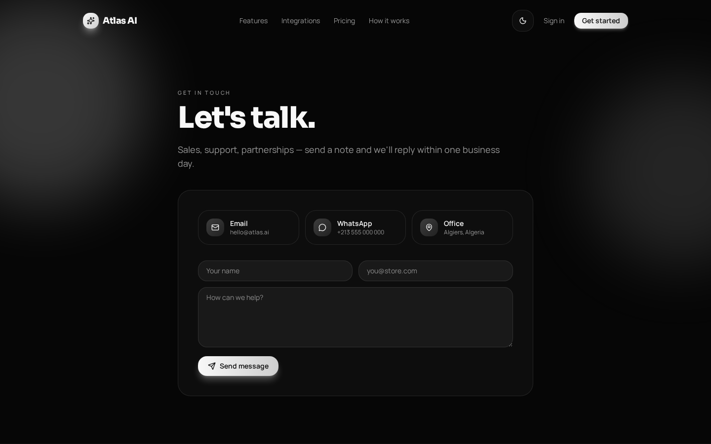
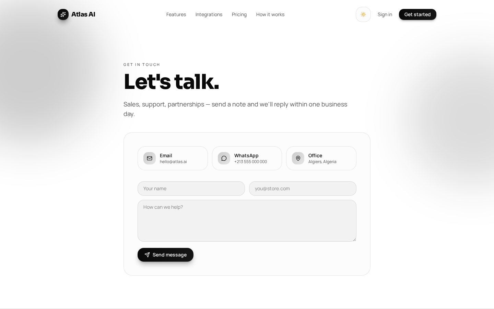
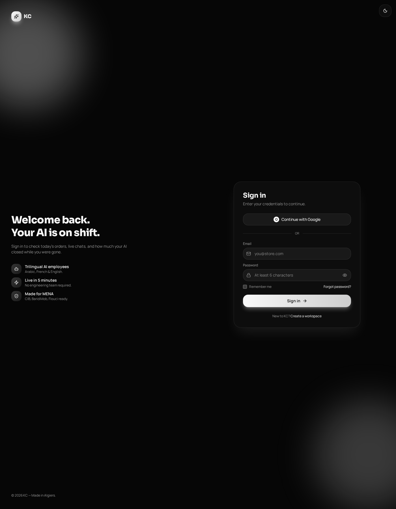
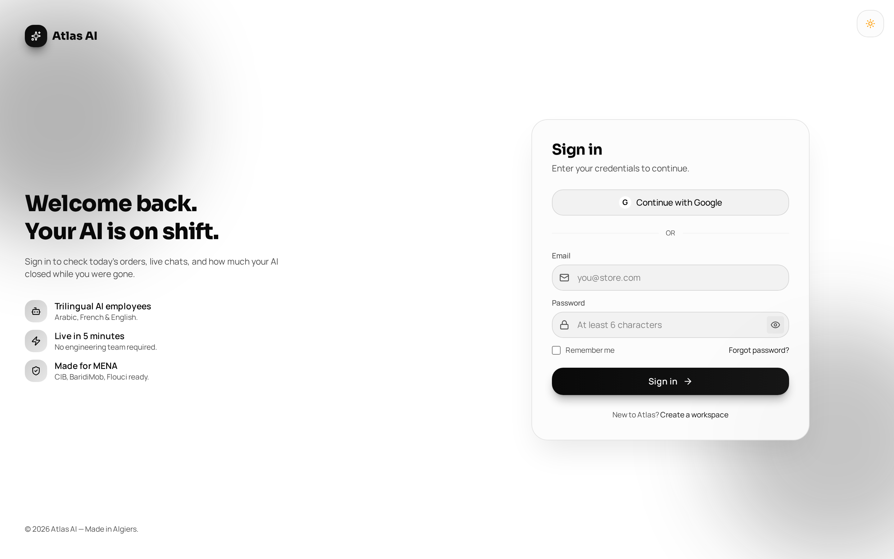
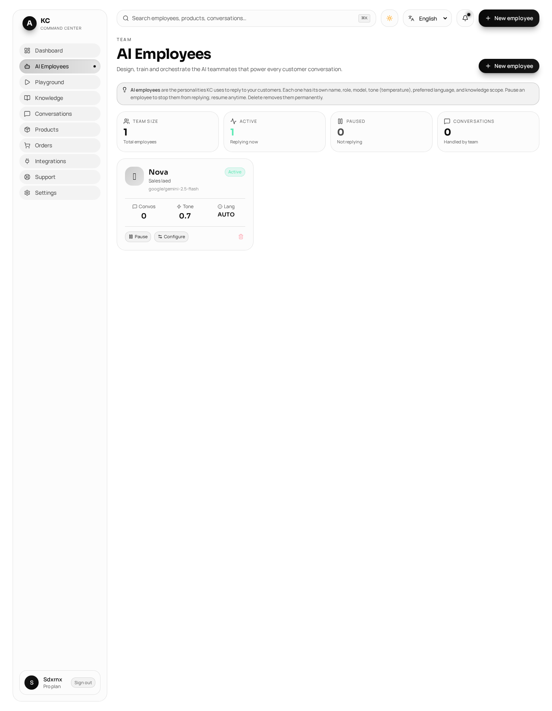
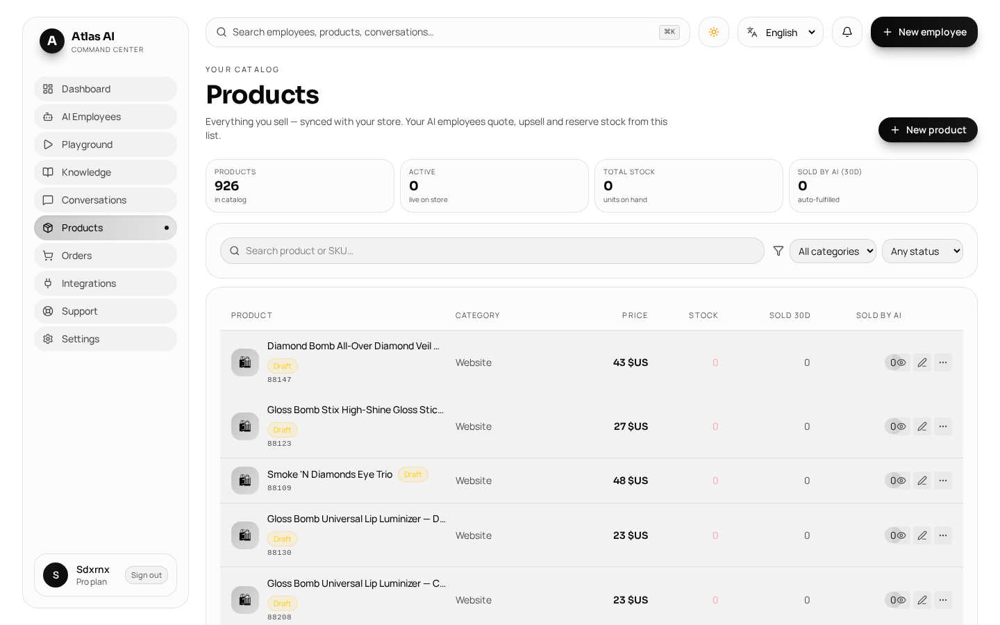
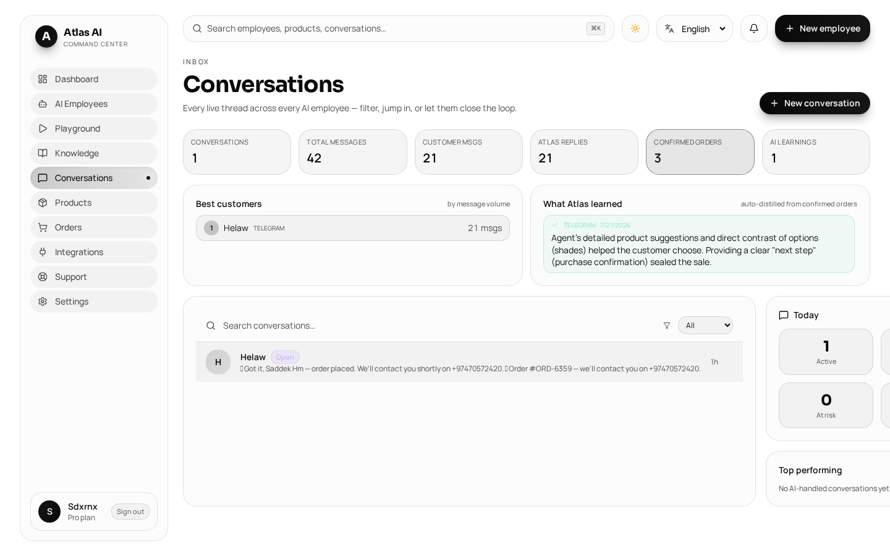
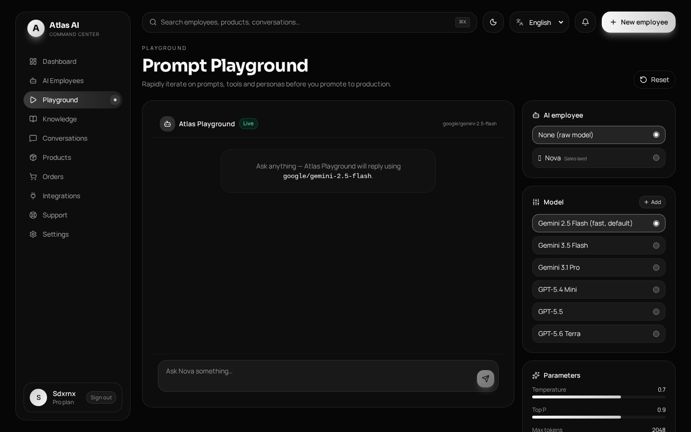
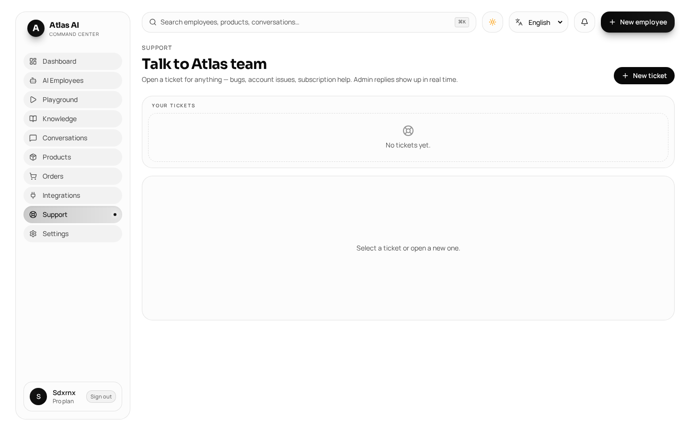

<div align="center">

# KC

**The AI workforce for North African commerce.**

Trilingual AI employees (Arabic · French · English) that sell, support, and grow
your store 24/7 across WhatsApp, Instagram, Messenger and Telegram.

<sub>Built with TanStack Start · React 19 · Tailwind v4 · Supabase · Cloudflare Workers</sub>

</div>

---

## Table of contents

- [What is KC?](#what-is-kc)
- [Screenshots](#screenshots)
- [Feature tour](#feature-tour)
  - [Marketing site](#marketing-site)
  - [Auth & onboarding](#auth--onboarding)
  - [Dashboard](#dashboard)
  - [AI Employees](#ai-employees)
  - [Products & catalog](#products--catalog)
  - [Orders & delivery](#orders--delivery)
  - [Conversations & inbox](#conversations--inbox)
  - [Integrations hub](#integrations-hub)
  - [Knowledge base](#knowledge-base)
  - [Playground](#playground)
  - [Settings](#settings)
  - [Support](#support)
  - [Admin panel](#admin-panel)
- [Architecture](#architecture)
- [Local development](#local-development)
- [Environment variables](#environment-variables)
- [Project structure](#project-structure)
- [Security & privacy](#security--privacy)
- [License](#license)

---

## What is KC?

KC is a full-stack conversational-commerce platform tailored for shops in
Algeria, Tunisia and Morocco. Store owners build **AI employees** that answer
customers, recommend products from their catalog, take orders, and hand off to
humans when needed — all in the customer's own language, on the channels the
customer already uses.

Highlights:

- **Native to the region** — 58 Algerian wilayas, COD/CIB/BaridiMob/Flouci/CMI,
  Arabic (Darija-aware), French, English out of the box.
- **Bring-your-own model** — OpenAI-compatible endpoints, Claude, Mistral,
  Gemini, or the built-in Lovable AI Gateway.
- **Everything in one workspace** — catalog, orders, conversations, delivery,
  knowledge, analytics, billing and admin.
- **Real-time & offline-friendly** — Supabase Realtime, PWA install prompt,
  optimistic UI.

---

## Screenshots

Every surface ships in both a dark and a clean white theme.

### Landing

| Dark | Light |
| --- | --- |
|  |  |

### Pricing

| Dark | Light |
| --- | --- |
|  |  |

### About & Contact

| About (dark) | Contact (dark) |
| --- | --- |
|  |  |

| About (light) | Contact (light) |
| --- | --- |
|  |  |

### Auth

| Login (dark) | Signup (dark) |
| --- | --- |
|  |  |

| Login (light) | Signup (light) |
| --- | --- |
|  |  |

### Dashboard

| Dark | Light |
| --- | --- |
|  |  |

### AI Employees

| Dark | Light |
| --- | --- |
|  |  |

### Products

| Dark | Light |
| --- | --- |
|  |  |

### Orders

| Dark | Light |
| --- | --- |
|  |  |

### Conversations

| Dark | Light |
| --- | --- |
|  |  |

### Integrations

| Dark | Light |
| --- | --- |
|  |  |

### Knowledge

| Dark | Light |
| --- | --- |
|  |  |

### Playground

| Dark | Light |
| --- | --- |
|  |  |

### Settings

| Dark | Light |
| --- | --- |
|  |  |

### Support

| Dark | Light |
| --- | --- |
|  |  |

### Admin

| Dark | Light |
| --- | --- |
|  |  |

---

## Feature tour

### Marketing site

- **Landing** — animated aurora hero, feature grid, live comparison table
  against the top 3 competitors, region-specific value props, launch discount
  bar, and social proof placeholders.
- **Pricing** — 3 tiers with a 14-day free trial, tricky launch discount
  applied at signup, per-region currency hints.
- **About / Contact / Terms / Privacy / Security / Status** — real content,
  proper metadata, JSON-LD, canonical + og:image per route.
- **Blog** — one seeded post (`/blog/future-of-ai-north-africa`) with Article
  schema, ready to extend.
- **Sitemap / robots / llms.txt** — `sitemap.xml` (public routes only),
  `robots.txt` disallows every authenticated surface, `llms.txt` for AI
  crawlers.
- **Public storefront** — `/store/:slug` renders a shop's live catalog
  without login.

### Auth & onboarding

- Email + password, Google OAuth (configured on first sign-in), password
  reset flow at `/reset-password`.
- 14-day free trial starts automatically; a trial banner in the app shows
  days left and prompts an upgrade when it ends.
- **Onboarding wizard** — 5 steps: workspace, brand voice, catalog source,
  channel connection (WhatsApp/Instagram/Messenger/Telegram/Viber with a
  live *Test connection* button), and finish. Every step can be skipped and
  revisited later from Settings.

### Dashboard

- **Bento command center** — KPI rail (revenue, orders, conversations,
  unread), "Since you were away" summary broken down per channel, live
  charts (recharts), latest orders, latest conversations, active AI
  employees, quick actions.
- Personalized welcome ("Welcome, {name}") using the signed-in profile.
- Realtime updates via Supabase Realtime — new orders and messages appear
  without a refresh.
- Admin broadcasts surface as a dismissible glass-morphism popup.

### AI Employees

- Create employees with role, tone, language, greeting, closing message,
  fallback behavior and advanced controls (temperature, max tokens, guardrail
  strictness, allow-list of topics).
- **Model picker** — Lovable AI Gateway, OpenAI, Claude, Mistral, Gemini or
  any OpenAI-compatible custom endpoint; live *Test connection* chip.
- **Templates marketplace** — starter employees for retail, restaurant,
  services; fork into your workspace in one click.
- Per-employee fine-tuning: workspace-only learnings feed built from
  confirmed conversations improves replies over time.

### Products & catalog

- Manual CRUD with rich fields (title, description, price, currency, stock,
  images, category, tags, SKU).
- **Import** — Shopify JSON, sitemap-based scraper for arbitrary websites
  (with a stock-accuracy warning), CSV planned.
- **Stats & filters** — filter by day/week/month, in-stock/out-of-stock,
  category; live counters for total value, low stock, out-of-stock.
- **Pagination** — default 8 per page, user-adjustable (8/16/32/64).
- Row menu rendered via portal so hover targets never conflict with card
  hover animations.

### Orders & delivery

- Full order lifecycle: pending → confirmed → shipped → delivered → cancelled,
  each with a history entry and optional private notes.
- **Statistics** — revenue chart, orders by status, orders by channel
  (site, WhatsApp, Instagram, Messenger, Telegram, Viber).
- **Algerian delivery module** — 58 seeded wilayas, workspace-scoped
  carriers (Yalidine, ZR Express, custom), per-wilaya shipping zones with
  home/desk pricing, COD amount, tracking number, carrier assignment from
  the order drawer.
- `calculate_shipping_fee` RPC quotes fees during AI conversations; the
  AI can answer "where is my order?" from the tracking table.
- Order fulfillment webhook (`/api/public/webhooks/fulfillment`) for external
  carriers to push status updates.

### Conversations & inbox

- Unified inbox across every connected channel with unread counters,
  channel filter, search and starred threads.
- **Real product cards** rendered inline when the AI recommends a match;
  one-click *Place order* creates an order attached to the conversation.
- **Human handoff** — flip a conversation to "needs human" and the AI
  stops replying; live agents can take over in place.
- **Learning feed** — confirmed conversations feed `workspace_learnings`
  so future replies improve automatically.
- Message counter shows total messages and best-performing conversations.

### Integrations hub

- **WhatsApp Business**, **Instagram**, **Messenger**, **Telegram** and
  **Viber** with OAuth or token flows and per-integration *Check
  connection* status chips.
- **Shopify / WooCommerce / YouCan** catalog sync (add credentials → import
  products → keep in sync).
- **Bring-your-own model** — OpenAI-compatible, Claude, Mistral, Gemini,
  custom base URLs.
- **Website scraper** — paste any URL; the scraper tries Shopify JSON first,
  falls back to sitemap discovery and HTML parsing. Warns the user when
  stock accuracy can't be guaranteed.
- Inbound webhook endpoints under `/api/public/webhooks/*` (Telegram, Meta)
  with signature verification.

### Knowledge base

- Sources: uploaded documents, pasted text, scraped URLs, FAQ pairs.
- Each source is chunked, embedded and available to every AI employee
  in the workspace.
- Full description of what the knowledge base does is shown inline so store
  owners understand what "training" means before they upload.

### Playground

- Live chat with any AI employee in your workspace before publishing.
- Model selector pinned at the top; conversation always auto-scrolls to the
  latest message.
- Rate-limited per user to keep AI spend predictable.

### Settings

- **Workspace** — name, logo, timezone, currency, region.
- **Brand voice** — tone, banned words, mandatory disclaimers.
- **Billing** — plan, trial status, invoices (mock provider, ready for
  Stripe or Paddle).
- **Notifications** — email, Slack channel, in-app.
- **Delivery** — carriers and per-wilaya shipping zones.
- **API & webhooks** — keys and outbound webhooks (scaffolded).
- **Team** — invite members, roles, remove.
- **Advanced** — backups/restore, GDPR data export/delete, referral program
  (+10 trial days per referral), 2FA (TOTP) with backup codes, audit log.
- **Appearance** — dark/light mode toggle, 11 color palettes, motion on/off,
  language (EN/FR/AR with RTL).

### Support

- Users open tickets that land directly in the admin queue.
- Threaded replies, status (open/pending/resolved), and attachments.
- Admin can jump from a ticket into the reporter's workspace.

### Admin panel

- Gated by role check; only the configured owner email reaches `/admin`.
- **Overview** — every KPI across every workspace: users, active
  workspaces, MRR, message volume, order volume, top channels.
- **Users** — search, ban/unban, impersonate, reset trial, view profile,
  view sessions, see audit trail.
- **Workspaces** — deep-dive per workspace with all stats, integrations,
  AI employees, orders, conversations; edit and fix issues directly.
- **Support** — live ticket queue with reply, close, escalate.
- **Broadcasts** — send an admin message that appears as a popup for every
  user on their next dashboard visit.
- **Security dashboard** — 2FA adoption, rate-limit blocks, recent security
  events, per-role audit.
- Destructive actions require **fresh 2FA** (8-hour verification window).

---

## Architecture

- **Framework** — [TanStack Start v1](https://tanstack.com/start) (React 19,
  file-based routing under `src/routes/`, server functions via
  `createServerFn`).
- **Bundler** — Vite 7, targeting **Cloudflare Workers** (`nodejs_compat`)
  for the SSR runtime.
- **Styling** — Tailwind v4 through `src/styles.css` with `@theme`,
  `oklch()` tokens and per-mode overrides. shadcn primitives for headless UI.
- **State** — TanStack Query for reads, Zustand-free context providers for
  preferences and toasts.
- **Backend** — Supabase (Postgres + Auth + Realtime + Storage) with strict
  RLS on every public-schema table and `GRANT` statements per role.
- **AI** — Lovable AI Gateway by default; per-workspace custom models via
  OpenAI-compatible endpoints.
- **Realtime** — Supabase Realtime channels for orders, conversations,
  presence heartbeat and admin broadcasts.
- **PWA** — `public/manifest.webmanifest`, install prompt component.
- **MCP** — `src/lib/mcp/` exposes workspace tools over MCP for agent
  integrations.

### Route map

```text
/                      Landing
/about, /contact       Marketing content
/pricing (#anchor)     Pricing on landing
/terms, /privacy       Legal
/security, /status     Trust & status
/blog/:slug            Blog post
/store/:slug           Public storefront
/sitemap, /sitemap.xml Sitemap
/login, /signup        Auth
/reset-password        Password recovery
/onboarding            5-step wizard
/dashboard             Bento command center
/ai-employees          AI employee CRUD + templates
/products              Catalog
/orders                Orders + delivery
/conversations        Unified inbox
/integrations          Channels, models, scraper
/knowledge             Knowledge base
/playground            Live chat
/settings              All settings
/support               User tickets
/admin                 Admin panel (role-gated)
/api/public/*          Public webhooks (signature-verified)
/mcp, /.mcp/*          MCP server
```

---

## Local development

```bash
bun install
bun run dev
```

The dev server starts on `http://localhost:8080`.

Useful scripts:

```bash
bun run build          # production build
bun run build:dev      # dev-style build (prerenders public routes)
bun run test           # vitest
bun run lint           # eslint
```

---

## Environment variables

Public (safe in the browser, prefixed with `VITE_`):

- `VITE_SUPABASE_URL`
- `VITE_SUPABASE_PUBLISHABLE_KEY`
- `VITE_SUPABASE_PROJECT_ID`

Server-only (never expose to the client):

- `SUPABASE_URL`, `SUPABASE_PUBLISHABLE_KEY` — server publishable client.
- `LOVABLE_API_KEY` — Lovable AI Gateway (auto-provisioned).
- `WEBHOOK_SECRET` — inbound webhook signature verification.

Copy `.env.example` to `.env` before running locally. Managed deployments
inject the Supabase variables automatically.

---

## Project structure

```text
src/
  routes/                 TanStack file-based routes
    api/public/           Public webhook endpoints
  components/
    marketing/            Landing, auth, onboarding
    pages/                Authenticated app pages
    app-shell.tsx         Sidebar + top bar
    dashboard.tsx         Bento dashboard
    admin-panel.tsx       Admin surfaces
  lib/
    *.functions.ts        Client-callable server functions
    *.server.ts           Server-only helpers
    mcp/                  MCP tools + server
    i18n.tsx              EN/FR/AR strings
    preferences.tsx       Theme/mode/language context
    auto-translate.tsx    MutationObserver translator
  integrations/supabase/  Generated Supabase clients (do not edit)
  styles.css              Tailwind v4 + theme tokens
supabase/migrations/      SQL migrations
docs/screenshots/         Screenshots used in this README
public/                   Static assets (favicon, manifest, robots, llms.txt)
```

---

## Security & privacy

- Row-level security on every public-schema table with explicit `GRANT`s
  per role.
- 2FA (TOTP) with backup codes; enforced for owner and admin actions.
- Per-user rate limits on sensitive endpoints via `public.rate_limit_hit`.
- Audit log (`public.security_events`) captures logins, admin actions,
  rate-limit blocks and 2FA failures.
- SSRF guard (`safeFetch`) on every outbound URL fetch (scraper, webhooks).
- Noindex middleware stamps `X-Robots-Tag: noindex` + `Cache-Control:
  private, no-store` on every authenticated response so intermediaries
  never cache private content.
- GDPR data export and delete tools available from Settings → Advanced.

---

## License

Proprietary — © KC.
